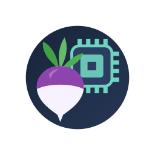

# DriverLab

DriverLab runs the same GPU tests on two Vulkan drivers on your Android
device and shows how they differ:

- the device's **own driver** (Qualcomm's on Adreno), and
- a **custom driver** you import, such as a Mesa Turnip AdrenoTools zip.

It can also record what each driver sends to the GPU and compare the two
register by register. Nothing on the device is changed: an imported driver
is loaded only inside DriverLab's own test program. No root needed.

**Download:** [latest release](https://github.com/The412Banner/DriverLab/releases/latest)
· arm64, Android 11 or newer.

## What it can do

- **Home is one dashboard:** driver A against driver B, Conformance or Speed test, one Start
  button and four live tiles (pass rate, tests per second, repeat, GPU health; for the speed
  test the live picture, frame time and the score). Upright it is one column; sideways (or on a
  wide screen) the setup sits on the left and the tiles on the right. Tests, Results, Drivers
  and Settings open from the icons at the top.

- **Tests**
  - the official Vulkan conformance tests (Khronos CTS 1.4.7.1, 3.2 million tests);
  - 68 OpenGL ES programs: the set used by the adreno-cmdstream-gather app
    (66 from freedreno, two written for DriverLab). They run on the device's
    own driver only.
- **Choosing tests:** browse by group, search, pick single tests, or use a preset:
  - Quick check: about a minute;
  - Driver info: what the driver reports;
  - Rendering basics;
  - Capture set: the adreno-cmdstream-gather test set.

  Every preset, group and test has an ⓘ button that explains what it checks.
- **Test lists:** load a `caselist.txt` (one test name per line, the format
  the Vulkan CTS uses; `group.*` for whole groups, `#` comments, and
  `name,Fail` lines from Mesa CI lists work too; any size, up to the full
  3.2 million names) or save the current selection as one (Tests › ⋮).
  From a finished run, the list button makes
  a list of its failed and crashed tests (or any other results) to run
  again, for example on another driver, or to save as a file.
- **Drivers:** import a zip or `.so`. DriverLab checks it right away
  (GPU name, Vulkan version, driver version). Each driver can have its own
  settings, such as `TU_DEBUG=sysmem`.
  - Qualcomm drivers taken from other phones (shared as AdrenoTools zips
    with their own `libgsl.so`, `libllvm-glnext.so` and so on) work too: every
    file in the zip is kept, and the driver's own libraries are loaded from
    its folder. Many of these were built for Android 15 or newer and can't
    load on older Android; the driver card then says so.
  - **Make a copy** (driver options): the same driver a second time with its
    own name and settings, for example GMEM on and off, without importing
    it again.
- **Game features** (Drivers › controller icon): what DXVK (Direct3D 9–11)
  and VKD3D-Proton (Direct3D 12) need from a driver, taken from their own
  code, plus Shader Model 6.6 (Unreal Engine 5 games), hardware ray tracing
  and mesh shaders. One check reads what a driver supports; two drivers can
  be compared side by side, and each profile has a focused test set.
- **Running:** a live screen shows progress, pass/fail counters, speed and
  time left. Runs keep going with the screen off. A test that crashes or
  hangs is marked as such, and the run continues. Settings › Test programs
  at once runs up to one test program per CPU core for faster big runs
  (recording always runs one at a time).
- **Run each test several times** (1, 3, 5 or 10): some bugs only show up
  now and then. A test whose runs give different results is marked
  "sometimes fails", with how many runs passed.
- **Check for GPU errors** (needs root): reads the kernel log while the tests
  run and ties GPU faults and hangs to the tests running at that moment. A
  test can pass while the GPU still reports a fault. Allow DriverLab in your
  root app first: Magisk 31.1 and newer no longer show a request prompt, so
  switch DriverLab on in Magisk's Superuser tab.
- **Then also run on** a second driver: the same tests run on both, then
  Compare opens.
- **Known to Mesa** (Turnip): failures that Mesa's own Turnip testing also
  gets, or calls unreliable, are labelled, with a "not known to Mesa" filter
  for the rest. Mesa has lists for a few Adreno GPUs (618, 660, 702, 750);
  for others the closest list of the same generation is used and the label
  says so.
- **Speed test** (Home): the same small Vulkan scenes on one or two
  drivers: a spinning cube, filling the screen, textures, many triangles,
  many draw calls, compute, memory speed, keep-the-picture passes (tile
  memory) and shader setup. Two drivers take turns (A then B, then B then
  A) with an optional cool-down pause, and a gap only counts as a win when
  it is bigger than the variation between rounds (and at least 3%). A small
  window shows what the driver draws, so a broken picture is easy to spot.
  The report is saved to Downloads.
- **Find a setting that fixes it** (Turnip): for a failed or crashed test,
  runs it again once per Mesa debug setting (`TU_DEBUG`, `IR3_SHADER_DEBUG`)
  and shows which ones make it pass; one tap adds a setting to the driver.
- **Recording (optional):** saves each test's GPU command stream as a
  freedreno `.rd` file.
  - On the device's own driver, this includes a full log of the driver's
    kernel calls, in the same format as freedreno's libwrap.
  - On Turnip, Mesa's own recorder is used.
- **Results:** sessions under day headers, with search and a "with
  problems" filter. A session's tests can be shown by group (with counts)
  or as a list, filtered, searched and sorted (problems first, name,
  slowest, run order). Each test shows its output, its CTS log and the GPU
  registers its recording wrote; arrows step to the previous or next test.
- **Compare:** pick two sessions to see which tests differ, then open a
  register-by-register diff, with register names, for any test recorded on
  both drivers.
- **Files:** everything a run saved, grouped by driver and session. Read,
  share, save a copy, copy to Downloads, or delete.

After every run DriverLab saves three files to `Download/DriverLab/<date>/`:

| File | Contents |
|---|---|
| `<time>_<driver>.zip` | everything: readable log, results table, CTS logs, test output, recordings |
| `<time>_<driver>_test_results.zip` | one `<test>.log` and one `<test>.rd` per test, the same layout as the adreno-cmdstream-gather app |
| `<time>_<driver>_results.log` | readable results with a time on every line |

To make the same `test_results` zip as the adreno-cmdstream-gather app:
choose **Capture set**, keep **System driver**, turn on
**Record GPU commands**, and press **Run**.

## How it works

| Part | What it is |
|---|---|
| `libdeqp_vk.so` | the Vulkan CTS, built as an Android program with the NDK (`cts/build-cts.sh`) |
| `libdlvkshim.so` | lets the CTS load a custom driver: Android HAL (`HMI`) or loader ICD, plus the libraries shipped with it (`native/vkshim`) |
| `libdlrec.so` | records the device driver's GPU submits as `.rd` and logs its kernel calls (`native/dlrec`) |
| `libtest_*.so` | the OpenGL ES test programs (`native/gles`, freedreno sources) |
| `libdlbench.so` | the speed test program, headless Vulkan scenes (`native/dlbench`) |
| Mesa's known results | Mesa's Turnip test lists, Vulkan lines only (`tools/make_mesa_expect.py`) |
| test catalog | a compact index of the CTS test list (`tools/make_catalog.py`) |
| register names | generated from Mesa's register database (`tools/make_regs.py`) |

Builds run on GitHub Actions (`.github/workflows/build.yml`). The CTS, the
native libraries, the test catalog and Gradle are cached separately, so a
normal app change builds in a few minutes. APKs are signed with the public
AOSP test key (v1, v2 and v3).

## Credits

- JetBrains Mono (numbers and test names in the app): The JetBrains Mono Project Authors, SIL Open
  Font License 1.1 (`app/src/main/assets/licenses/JetBrainsMono-OFL.txt`).

- Khronos Group: Vulkan CTS (Apache 2.0).
- Rob Clark and the freedreno and Mesa developers: the OpenGL ES test
  programs, the `.rd` format and libwrap, the register database,
  Turnip's `FD_RD_DUMP`, and the `TU_DEBUG` / `IR3_SHADER_DEBUG` settings
  and their descriptions (MIT).
- Philip Rebohle and the DXVK developers, Hans-Kristian Arntzen and the
  VKD3D-Proton developers: the driver requirements Game features checks
  are read from their code (no code from them is included).
- Huggo: the adreno-cmdstream-gather app.
- Hugo: the report and fix idea for loading Qualcomm drivers taken from
  other phones, test lists, no list size limit, and running test programs
  at once.
- Kimchi (K11MCH1): the ideas behind Game features and Find a setting
  that fixes it.
- vauzi (Vauzi-17): for sharing that app and for the Adreno 710/720/722
  register work that started DriverLab.
